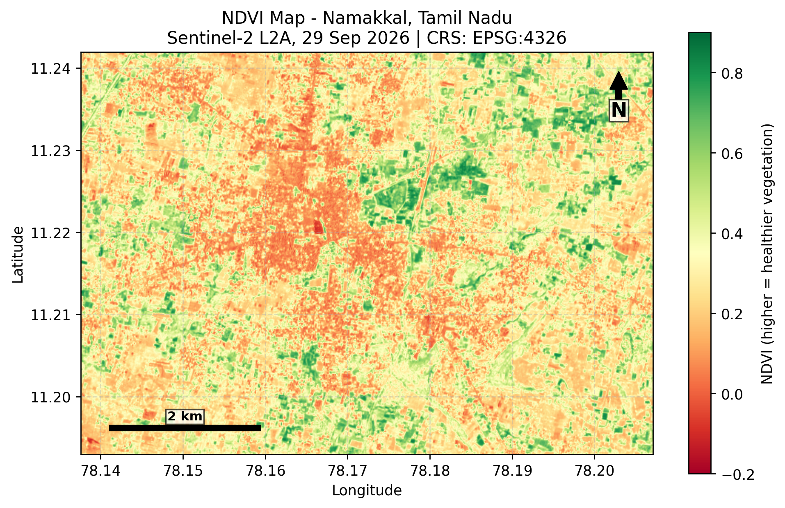

# NDVI Vegetation Health & Land Cover Mapping: Namakkal, Tamil Nadu

Remote sensing and GIS project using Sentinel-2 imagery to map vegetation health with NDVI, detect surface water with NDWI, and group land cover with unsupervised machine learning.

## Objective
Map vegetation health and land cover around Namakkal using free satellite data, with a reproducible Python workflow and georeferenced outputs.

## Data
- Sentinel-2 L2A, acquired 29 Sep 2026 (Copernicus Data Space Ecosystem)
- Bands: B03 (green), B04 (red), B08 (NIR), 10 m resolution
- Study area: Namakkal town and surroundings, 545 × 773 pixels, about 4,113 ha
- CRS: WGS 84 (EPSG:4326)

## Method
1. **NDVI** = (NIR − Red) / (NIR + Red), classified into four vegetation classes
2. **NDWI** = (Green − NIR) / (Green + NIR), used to detect surface water
3. **K-Means clustering** (k = 4) on green, red, NIR and NDVI, with standardised features. Clusters were ranked by mean NDVI and labelled for interpretation.
4. **Area statistics:** pixel area was computed from the raster geotransform to convert pixel counts into hectares
5. **GIS export:** NDVI saved as a georeferenced GeoTIFF, compatible with QGIS

## Results

### NDVI classes
| Class | Area (%) | Area (ha) |
|---|---|---|
| Water/cloud (< 0) | 0.2 | 8.2 |
| Bare/built-up (0–0.2) | 25.9 | 1,063.9 |
| Sparse vegetation (0.2–0.5) | 60.1 | 2,469.9 |
| Dense vegetation (> 0.5) | 13.9 | 571.0 |

### K-Means land cover clusters
| Cluster | Area (%) | Area (ha) |
|---|---|---|
| Bare soil / built-up | 5.8 | 240.6 |
| Sparse vegetation | 22.5 | 925.5 |
| Moderate vegetation | 50.0 | 2,056.3 |
| Dense vegetation | 21.7 | 890.6 |

Silhouette score: **0.382**

### Surface water (NDWI)
Water pixels (NDWI > 0) cover about **5.0 ha**, mainly a small water body near the town centre.

## Repository contents
| File | Description |
|---|---|
| `ndvi_map_final.png` | NDVI map with scale bar, north arrow and coordinates |
| `landcover_map.png` | K-Means land cover clusters |
| `ndwi_map.png` | NDWI water map |
| `ndvi_namakkal.tif` | Georeferenced NDVI GeoTIFF (opens in QGIS) |
| `*.ipynb` | Full analysis notebook |

## Limitations
- K-Means is unsupervised and there is no ground-truth data, so the silhouette score measures cluster separation, not classification accuracy
- Cluster names are based on mean NDVI, so bare soil and built-up areas are not separated
- The NDVI and K-Means class areas differ because K-Means uses four features while the NDVI classes use thresholds on one
- Single acquisition date, with no cloud or shadow masking
- Hectare values are approximate because they come from a geographic (degree-based) CRS

## Future work
- Supervised Random Forest classification using labelled polygons (accuracy and confusion matrix)
- Validate NDVI against the raw-value Copernicus NDVI product
- Multi-date NDVI change detection
- Sentinel-1 SAR for monsoon-season analysis

## Tools
Python, rasterio, NumPy, scikit-learn, Matplotlib, Google Colab
